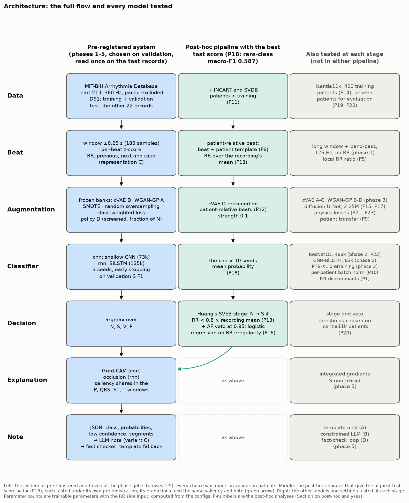
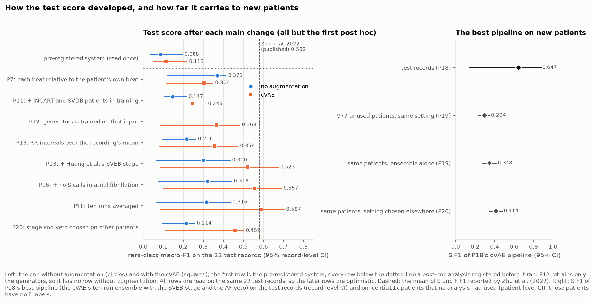
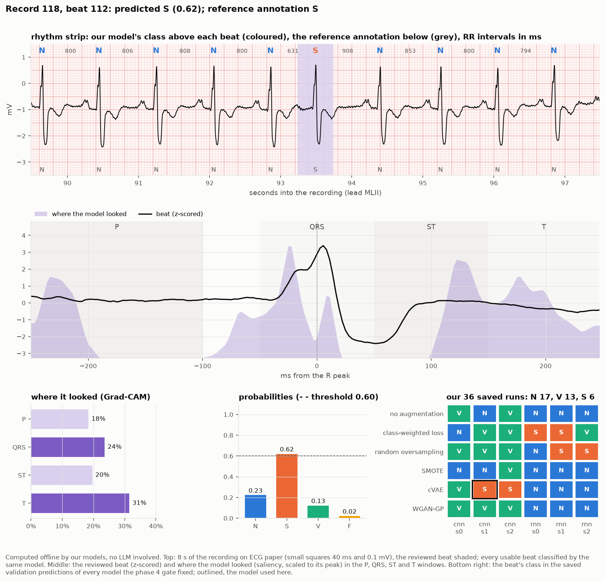

# Rare-arrhythmia detection with generative ECG augmentation

Can a generative model that creates synthetic heartbeats (a conditional VAE or a WGAN-GP) help a classifier detect the
rare arrhythmia beats, when the patients it is tested on were never seen in training? This repository holds the whole
study on the MIT-BIH Arrhythmia Database: the data pipeline, the classifiers, the generators, the comparison with the
usual ways of handling class imbalance, saliency explanations, LLM-written notes guarded by a fact checker, and a demo.
A course project for CS787: GenAI, run in pre-registered phases from 2026-10-07 to 2026-11-13.

**The course report:** a 10-page version with the main findings, what we built and what it means,
[report/report_brief.pdf](report/report_brief.pdf); the full report [report/report.pdf](report/report.pdf) (29 pages); or the 20-page
version [report/report_short.pdf](report/report_short.pdf). Every results table is also in [report/results.md](report/results.md).

**The demo:** `./demo.sh` (see [Demo](#demo)).

**Authors:** Akash Saha - 261110401, Kartheek Dasari - 261110029, H M Karthik - 261110025, T D Manindra 261050084.

## The question and the setup

- **Beat classes** (AAMI EC57): N normal, S supraventricular ectopic, V ventricular ectopic, F fusion. The rare classes
  are S and F; Q beats (about 15 in all) are left out.
- **Patients kept apart** (the inter-patient protocol of de Chazal et al., 2004): the 22 DS1 records are used for training
  (17 records) and validation (5 records: 115, 118, 201, 205, 223); the 22 DS2 records are the test set. The four paced
  records are excluded. Lead MLII, 360 Hz.

  | Split | Records | N | S | V | F |
  | :--- | ---: | ---: | ---: | ---: | ---: |
  | training | 17 | 35,496 | 644 | 3,030 | 388 |
  | validation | 5 | 10,370 | 300 | 758 | 27 |
  | test (DS2) | 22 | 44,259 | 1,837 | 3,221 | 388 |

- **Primary measure:** rare-class macro-F1, the mean F1 of S and F on the test records, with 95% confidence intervals
  from a bootstrap over records (patients), and Holm's correction for the confirmatory tests.
- **Rules fixed in advance:** every selection rule was written down before the experiments it governs
  ([docs/PREREGISTRATION.md](docs/PREREGISTRATION.md)); every choice was made on the validation patients and approved at
  a gate at the end of each phase; the test records were read once for the final evaluation. Each later read is logged
  in [docs/TEST_ACCESS_LOG.md](docs/TEST_ACCESS_LOG.md), and the code refuses to read the test file otherwise.

## The system



The pre-registered system (left column), chosen phase by phase on validation:

| Phase | What was chosen | Outcome |
|---|---|---|
| 1 data | how a beat is shown to the model | ±0.25 s around the R peak (180 samples), z-scored, plus three RR-interval features |
| 2 baselines | two classifiers, a synthetic-quality score, PTB-XL pretraining | a shallow CNN ("cnn", 73k parameters) and a BiLSTM ("rnn", 135k); quality = DTW + spectral distance; PTB-XL pretraining tied with training from scratch, so it was not used |
| 3 generators | one cVAE and one WGAN-GP design | cVAE variant D, WGAN-GP variant A; their synthetic beat banks frozen |
| 4 comparison | how synthetic beats are added, and how many | policy D: each minority class brought up to a fraction (the strength: 0.1, 0.25 or 0.5) of the training N count with synthetic beats, keeping from twice as many generated beats those closest to real training beats by DTW; strength chosen per condition; 96 training runs |
| 5 explanations | saliency method, note generator | Grad-CAM (cnn), occlusion (rnn); notes by Gemini (gemini-3.5-flash-lite) from a JSON of the model's output, with a fact checker and a template fallback |

Six conditions were compared for each classifier, each with three seeds: no augmentation, class-weighted loss, random
oversampling, SMOTE, the cVAE and the WGAN-GP.

## Results

### The pre-registered comparison (the test records, read once)

| Classifier | Condition | Strength | Rare-class macro-F1 [95% CI] | N recall |
| :--- | :--- | ---: | ---: | ---: |
| cnn | none | – | 0.088 [0.037, 0.194] | 0.962 |
| cnn | class-weighted loss | 0.5 | 0.113 [0.057, 0.207] | 0.933 |
| cnn | random oversampling | 0.1 | **0.136** [0.061, 0.247] | 0.844 |
| cnn | SMOTE | 0.1 | 0.070 [0.025, 0.172] | 0.985 |
| cnn | cVAE | 0.25 | 0.113 [0.049, 0.217] | 0.938 |
| cnn | WGAN-GP | 0.1 | 0.079 [0.033, 0.164] | 0.955 |
| rnn | none | – | 0.075 [0.014, 0.232] | 0.961 |
| rnn | class-weighted loss | 0.75 | 0.061 [0.022, 0.168] | 0.865 |
| rnn | random oversampling | 0.1 | 0.090 [0.028, 0.196] | 0.883 |
| rnn | SMOTE | 0.1 | 0.086 [0.025, 0.206] | 0.894 |
| rnn | cVAE | 0.1 | 0.073 [0.035, 0.157] | 0.926 |
| rnn | WGAN-GP | 0.5 | 0.069 [0.027, 0.156] | 0.857 |

Per class, the cnn with the cVAE reaches N recall 0.938 and V F1 0.893, near published inter-patient results (Huang et
al. 2014: V F1 0.924), but S F1 only 0.173 and F F1 0.054: the rare beats of new patients are the hard part.

### The hypotheses: how each was tested and what we found

Four hypotheses were registered before any test record was read, and each was tested once on the 22 test patients,
with confidence intervals from a bootstrap over patients and Holm's correction for the confirmatory family. Behind them
are 761 logged runs (240 in the pre-registered phases, 521 in the follow-up analyses), 21 versions of the
pre-registration and a gate approval at the end of every phase. The verdicts below are the pre-registered rules applied
literally; the evidence column shows what each test found.

| Hypothesis | How it was tested | What we found | Verdict |
|---|---|---|---|
| **H1** (confirmatory): generative augmentation improves rare-class macro-F1 over no augmentation | Two generator families (cVAE, WGAN-GP), four designs of each piloted, the two winners trained with three seeds into six frozen synthetic banks; the augmentation policy chosen in a 27-run pilot; a 96-run grid (2 classifiers × 3 seeds × no augmentation plus 5 conditions at 3 strengths each), every strength chosen on validation; four confirmatory comparisons | The cVAE was the best generative condition on validation for both classifiers. On test, the cnn with the cVAE moved in the hypothesised direction: rare-class macro-F1 +0.025 (95% CI −0.018 to +0.047), S F1 and F F1 +0.025 each, F sensitivity 0.064 → 0.185, and the highest four-class macro-F1 of all twelve models (0.517). No difference survived Holm's correction, with or without record 202 | Not supported at this sample size |
| **H1b** (exploratory): the gain is larger for F than for S | Per-class F1 differences against no augmentation, for each generator and classifier | F gained more than S with both generators on the rnn (cVAE F +0.007 vs S −0.011; WGAN-GP F +0.013 vs S −0.025); equal gains for the cnn with the cVAE (+0.025 each) | Mixed (2 of 4) |
| **H1c** (secondary): generative augmentation beats SMOTE, random oversampling and class-weighted loss | The best generative condition on validation (the cVAE, for both classifiers) against each of the three, six comparisons with Holm's correction | The cVAE matched the cheap methods: for the cnn +0.044 vs SMOTE, +0.001 vs class-weighted loss, −0.022 vs random oversampling; for the rnn within ±0.016 | Not supported: on par, not above (0 of 6) |
| **H2** (exploratory): evaluating with the same patients in training and test inflates the baseline and the gains | A leakage audit after the final evaluation: the same cnn trained and tested on a random beat-level split of all 44 records (15 runs), repeated on two more random splits (P4) | The baseline's rare-class macro-F1 rose from 0.088 to 0.837 ± 0.026 (+0.748), and to 0.803 and 0.777 on the other two splits; the generators' gains were not larger there (cVAE −0.017, WGAN-GP −0.052) | Not consistent: inflation strongly confirmed, larger gains not |
| **H3** (exploratory): a synthetic-quality metric predicts the gain from augmentation | First a sanity harness for four metric families on deliberately degraded beats (DTW and spectral passed; the FID analogue and TSTR failed), then five metrics (DTW, spectral, diversity ratio, memorization fraction, C2ST accuracy) correlated with the downstream gain over 96 checkpoints of 24 generator runs | No metric had an interval excluding zero (Spearman ρ from −0.20 to +0.18): synthetic beats that look closer to real ones did not give larger gains | Not supported (0 of 5) |
| **H4** (exploratory): augmented models are at least as faithful in their saliency as the baseline | Four saliency methods (Grad-CAM, integrated gradients, SmoothGrad, occlusion) scored for faithfulness (deleting the most salient samples against random deletion) and stability; Grad-CAM chosen for the cnn, occlusion for the rnn | Faithfulness gain over random deletion: cnn none +0.152, cVAE +0.118, WGAN-GP +0.157; rnn none +0.113, cVAE +0.054, WGAN-GP +0.092. The cnn with the cVAE shifted its saliency to the QRS window on synthetic beats (0.48 against 0.34 on real ones) | Mixed (1 of 4: the cnn with the WGAN-GP) |

The negative verdicts are results, not missing work: under a strict inter-patient protocol, with 17 training patients,
generative augmentation performed on par with the cheap balancing methods, and synthetic quality did not predict
usefulness. The confidence intervals are wide because the rare beats sit in a few patients; showing an effect of the
size seen for the cnn with the cVAE needs more patients with rare beats.

### After the final evaluation: 23 follow-up analyses

Each follow-up analysis (P1 to P23) was pre-registered before it ran, read the test records at most once, and is
reported apart from the primary results. They changed the beat input (each beat relative to the patient's own beats),
added patients from other databases, added a third generator family (diffusion), physics-based losses, a larger
classifier, averaging over ten runs, and a rule-based S stage with an atrial-fibrillation veto.



| On the 22 test records | S F1 | F F1 | V F1 | Rare-class macro-F1 [95% CI] |
| :--- | ---: | ---: | ---: | ---: |
| pre-registered, cnn with the cVAE | 0.173 | 0.054 | 0.893 | 0.113 [0.049, 0.217] |
| **P18: the cVAE's ten-run ensemble, S stage and AF veto** (also trained on INCART and SVDB patients) | **0.647** | **0.527** | 0.936 | **0.587** [0.086, 0.702] |
| P20: the same, its settings chosen on other patients (Icentia11k) | 0.391 | 0.527 | 0.936 | 0.459 [0.110, 0.500] |
| Zhu et al. 2022 (published, inter-patient) | 0.686 | 0.477 | 0.960 | 0.582 (mean of S and F F1) |

On 977 patients of the Icentia11k database that no analysis had used, the P18 pipeline reached S F1 0.294 [0.237, 0.350]
with its own settings and 0.414 with the settings chosen on other patients (P20); Icentia11k has no F labels.

What the follow-up analyses established:

- **Patient-relative beats** (each beat taken relative to the patient's own beats, P7) raised the cnn's test rare-class
  macro-F1 without augmentation from 0.088 to 0.371 (S F1 0.148 → 0.312, F F1 0.029 → 0.429): the largest step in the
  figure above came from the input, not from the generator.
- **The atrial-fibrillation veto** (P16) raised rare-class macro-F1 in all six conditions (+0.018 to +0.034), every 95%
  interval above zero (Holm p 0.018 to 0.057).
- **Averaging ten runs** (P18, P19) raised S F1 on the 977 unseen patients in five of six conditions (Holm p 0.001), and
  on the test records lifted the WGAN-GP pipeline by +0.099 (Holm p 0.006).
- **Choosing the settings on other patients** (P20) raised S F1 on the 977 unseen patients in all six conditions (the
  cVAE from 0.294 to 0.414, Holm p 0.001).
- **A larger classifier** (ResNet1D, P22) beat the cnn on the unseen patients with the cVAE (+0.023, Holm p 0.002) and the
  WGAN-GP (+0.058, Holm p 0.0006).
- **The leakage inflation** held on two more random splits (P4), and **five seeds** instead of three changed no verdict
  (P3).

### What this means

- With patients kept strictly apart and 17 training patients, generative augmentation did not detectably improve rare-
  class detection over no augmentation or the simple balancing methods; the cVAE's effect on the cnn points the right
  way but is within the noise. Showing it needs more patients with rare beats and more runs: the test S beats come
  mostly from one record (232 holds 1,381 of the 1,836 usable test S beats).
- The same models score near 0.84 when beats of the same patients are in training and test, so results from such
  splits say little about new patients.
- Normal and V beats are detected at about the published level; S and F beats need patient-relative inputs, more
  training patients and the RR-based S stage to reach it. The best pipeline (P18) matches published inter-patient
  results on the test records, but it was built after the final evaluation and its interval is wide; on unseen
  patients it is lower, so it needs confirmation on more patients.

## Demo

```bash
./demo.sh                          # a tour: one N, S, V and F beat, Enter between beats
./demo.sh S                        # one example beat: N, S, V or F
./demo.sh --list                   # beat positions to choose from, per validation record
./demo.sh --record 118 --beat 112  # any validation beat
```

`demo.sh` works from any folder; it runs `uv run python -m ecgaug.demo` in the repository. For each beat it prints three
parts:

1. **Offline analysis by our models, with no LLM:** the prediction and probabilities, the RR intervals, a rhythm strip
   (every beat in the 8 s around it classified by the same model, next to the cardiologists' annotation), where the
   model looked (the share of saliency in the P, QRS, ST and T windows), how all 36 saved runs (2 classifiers × 6
   conditions × 3 seeds) classified the beat, and a figure of all of it, which opens by itself.
2. **A review by Gemini,** written as a cardiologist's short report (findings, impression, confidence, next step) from
   those results only; Gemini never sees the signal.
3. **The review checked against the offline results:** every number, class and segment it names, next to the value it
   restates. A review with a claim the results do not hold (a wrong number, or a rhythm, conduction or waveform finding)
   is sent back at most twice and otherwise replaced by the same report filled in offline.

Gemini needs `GEMINI_API_KEY` in the environment (free tier from aistudio.google.com); without it the review is filled
in offline. The demo uses validation records only. The tour's four beats are examples the model classifies correctly;
the 36-run panel shows how often other models disagree.



## Reproducing

```bash
uv sync                                      # Python environment from uv.lock
uv run pytest                                # the test suite (leakage, test lock, metrics, bootstrap, runners, gates)
uv run python -m ecgaug.data.raw             # download MIT-BIH from PhysioNet and verify checksums
uv run python -m ecgaug.workflow status      # every phase's checklist, ticked where done, with its command
```

Every experiment can be checked end to end on fake data in minutes (each run below leaves the repository unchanged):

```bash
uv run python -m ecgaug.experiments.phase1_input_representation --config configs/phase1_input_representation/C_short_window_rr_features.yaml --smoke
uv run python -m ecgaug.experiments.phase2_ptbxl_pretraining --config configs/phase2_ptbxl_pretraining/A_short_window.yaml --smoke
uv run python -m ecgaug.experiments.phase2_baseline_classifiers --config configs/phase2_baseline_classifiers/A_shallow_cnn.yaml --smoke
uv run python -m ecgaug.experiments.phase2_quality_metrics --config configs/phase2_quality_metrics/A_dtw.yaml --smoke
uv run python -m ecgaug.experiments.phase3_cvae --config configs/phase3_cvae/A_conv_concat.yaml --smoke
uv run python -m ecgaug.experiments.phase3_wgan_gp --config configs/phase3_wgan_gp/A_concat_embedding.yaml --smoke
uv run python -m ecgaug.experiments.phase4_augmentation_policy --config configs/phase4_augmentation_policy/B_fraction_of_n.yaml --smoke
uv run python -m ecgaug.grid.runner --config configs/phase4_full_grid/dry_run_baselines.yaml --smoke
uv run python -m ecgaug.experiments.phase5_explainability --config configs/phase5_explainability/B_integrated_gradients.yaml --smoke
uv run python -m ecgaug.experiments.phase5_clinical_notes --config configs/phase5_clinical_notes/A_template.yaml --smoke
uv run python -m ecgaug.demo --smoke
```

`ECGAUG_REHEARSAL=1 uv run pytest tests/test_rehearsal.py` runs every phase, gate, the final evaluation, the leakage
audit and the report in order on fake records (about 8 minutes). The real runs trained on Kaggle GPUs: each notebook in
[kaggle/](kaggle/) clones the repository at a commit and runs one config ([kaggle/README.md](kaggle/README.md));
`scripts/reproduce.sh` lists the whole order. Model weights and synthetic banks are too large for git and travel in the
Kaggle run bundles.

`python -m ecgaug.paper` rewrites the report's tables, numbers and results texts (`report/generated/`,
`report/results.md`) from the result files; `cd report && tectonic report.tex` compiles the report. No number in the
report is typed by hand.

**The test set is locked:** DS2 is readable only through `ecgaug.data.load_test()`, which refuses unless `ALLOW_TEST=1`
is set by the final evaluation; building the test array needs `ALLOW_TEST_BUILD=1`. The leakage audit
(`ALLOW_TEST_AUDIT=1`) and the follow-up analyses (`ALLOW_TEST_POSTHOC=1`) are allowed only after the final evaluation.
Every access is logged in [docs/TEST_ACCESS_LOG.md](docs/TEST_ACCESS_LOG.md).

## Repository layout

| Path | Contents |
|---|---|
| `src/ecgaug/` | the package: `data` (MIT-BIH pipeline, PTB-XL preprocessing, R-peak detector), `eval` (metrics, bootstrap, selection rules), `models` (probe and the four baselines), `train`, `generators` (cVAE, WGAN-GP, banks), `quality` (diagnostics, metric families, sanity harness), `augment` (policies, SMOTE, oversampling, class weights), `grid` (the grid runner), `experiments` (one runner per experiment), `explain` (saliency and its scores), `report` (notes, the demo's review and the fact checkers, error analysis), `final_eval`, `demo`, `paper`, `workflow` (status and gates) |
| `configs/` | one folder per experiment (`<experiment>/<letter>_<name>.yaml` plus a shared settings file), `validation_split/`, `phase4_full_grid/` |
| `report/` | the course report: `report.pdf` (29 pages), `report_short.pdf` (20 pages) and `report_brief.pdf` (a 10-page version), their LaTeX sources and references, `generated/` (the tables, numbers and texts it inputs) and `results.md`; see [report/README.md](report/README.md) |
| `results/` | generated summaries: counts, variant results, gate reports, the final evaluation, `manifest.json` (what is frozen, with hashes) |
| `figures/` | figures for every phase and analysis, made by code; [figures/README.md](figures/README.md) lists what each folder shows |
| `demo.sh` | the demo from any folder |
| `kaggle/` | one notebook per job, the runner and the ingest script; start with [kaggle/README.md](kaggle/README.md) |
| `runs/` | one folder per training run (config, environment, training curve, validation metrics and predictions) |
| `docs/` | plan, pre-registration, decisions, progress log, test-access log, naming, the phase-by-phase checklist, variant briefs |
| `tests/` | leakage, test lock, contract, metrics, bootstrap, runners, gates, the demo and the dress rehearsal |
| `scripts/` | `reproduce.sh` (the whole pipeline in order) and three gate figures |
| `Papers/` | reference papers |

## Further reading

| Document | What it holds |
|---|---|
| [PROJECT_GUIDE.md](PROJECT_GUIDE.md) | the whole project in plain words: question, data, phases, decisions, what was checked |
| [CODE_GUIDE.md](CODE_GUIDE.md) | what each code file and function does |
| [docs/PLAN.md](docs/PLAN.md) | phases, experiments, variants, gates and the data protocol |
| [docs/PREREGISTRATION.md](docs/PREREGISTRATION.md) | every selection rule and hypothesis, versions 1 to 21, written before the experiments |
| [docs/DECISIONS.md](docs/DECISIONS.md) | every decision and amendment, with who asked for it |
| [docs/PROGRESS.md](docs/PROGRESS.md) | the day-by-day log, with run IDs |
| [docs/TEST_ACCESS_LOG.md](docs/TEST_ACCESS_LOG.md) | every read of the test records |
| [docs/PHASE1_REPORT.md](docs/PHASE1_REPORT.md) | the phase 1 analysis of the data and the validation split |
| [docs/CHECKLIST.md](docs/CHECKLIST.md) | every item of every phase with its command and outcome, and the working notes for running things |
| [docs/NAMING.md](docs/NAMING.md) | the naming scheme: phase, experiment, variant, run |

## Limitations

- Few patients carry the rare beats: 17 training patients, and most test S beats come from one record, so the
  confidence intervals are wide. Records 201 (training side) and 202 (test) are the same person; the report also gives
  the test results without record 202.
- The follow-up analyses were designed after the test records had been read once. Each was pre-registered and is
  labelled post hoc, but all read the same 22 test records, so their scores are optimistic; the unseen Icentia11k
  patients give the fairer estimate.
- The notes and the demo's review only restate the model's output. They are not a diagnosis, and every one ends with
  that statement.
