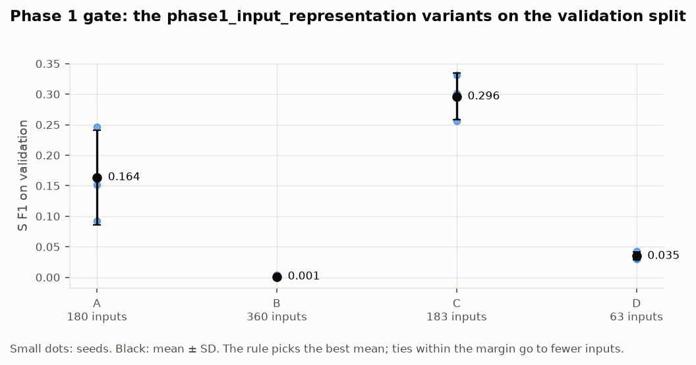
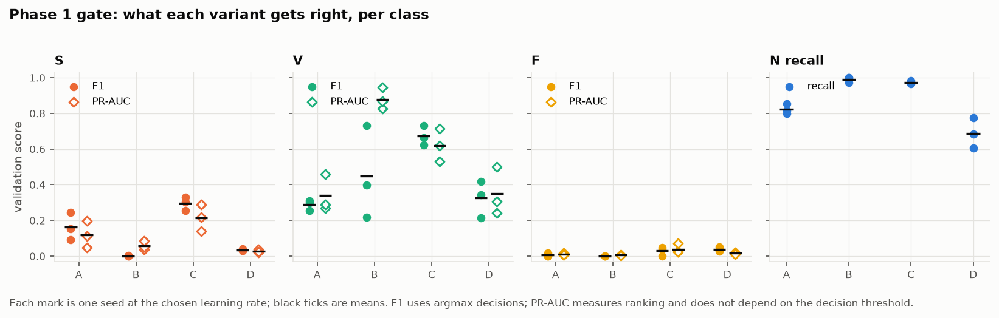
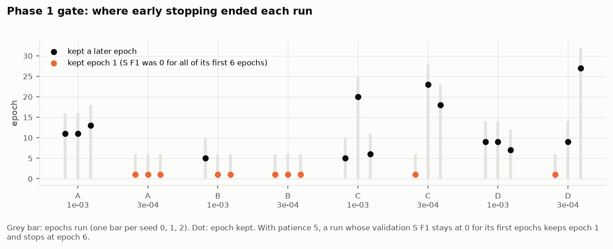

# Phase 1 report: phase1_input_representation results

Written 2026-10-16 (Day 10) from the runs merged in PRs #1 and #2. Every number here comes from
`results/phase1_input_representation/<letter>.json`, the run folders under
`runs/phase1_input_representation/`, or `results/phase1_gate/report.md`. Run IDs are listed in the
appendix. All numbers are on the **validation split V1** (records 115, 118, 201, 205, 223). No test data
was read: `docs/TEST_ACCESS_LOG.md` has no new entry since 2026-10-08.

## 1. Summary

- **Variant C (short window + RR features) wins the phase 1 gate**, with validation S F1
  **0.296 ± 0.038** (mean ± SD over 3 seeds). The next best is A at 0.164 ± 0.078. The gap is 0.133 and
  the tie margin is 0.061, so this is a clear win, not a tie-break. The rule is applied by
  `python -m ecgaug.workflow phase1-gate`, and all four checks pass. **Status: pending team approval.**
- **RR timing is what makes S beats detectable.** C is A plus three RR numbers. Adding them raises
  S F1 from 0.164 to 0.296 and V F1 from 0.288 to 0.672. It also stops normal beats being misread as V:
  that error falls from 15.8% to 0.7%.
- **Even the winner misses most S beats.** C labels 56% of true S beats as V and finds only 27% of them.
  This is the main error left for later phases to fix.
- **F cannot be measured on validation.** There are only 27 F beats, and every variant labels about
  78% of them N (F F1 ≤ 0.04). This is why selection uses S F1. F is a job for augmentation (phase 3–4).
- **The early-stopping rule has a flaw that hit 10 of the 24 runs.** A run whose validation S F1 is
  exactly 0 for its first epochs keeps epoch 1 and stops at epoch 6. Variant B's 0.001 is mostly this
  flaw, not a measure of its inputs: B has the best V PR-AUC of any variant (0.879). This does not
  plausibly change the winner (section 6), but it should be fixed before phase 2 runs.
- **Audit:**
  - same code for all variants;
  - every run's config matches the committed configs;
  - A, C and D datasets rebuild bit-for-bit;
  - B's dataset hash differs on macOS (section 7);
  - all 24 reported runs are flagged `git_dirty` (cause unknown, configs verified).

## 2. What was run

Four input representations were fed to the same small probe CNN (~18.6k parameters). Every variant
had the same budget:
- seeds 0, 1, 2;
- learning rates 1e-3 and 3e-4;
- at most 40 epochs;
- patience 5 on validation S F1;
- batch 256, weight decay 0.01.

The learning rate with the best mean S F1 is kept per variant.

| variant | input | inputs per beat | who ran it | where |
|---|---|---|---|---|
| A `A_short_window` | ±0.25 s around R at 360 Hz, per-beat z-score, no filter | 180 | Manindrathatuthuri | Kaggle T4 GPU |
| B `B_long_window_bandpass` | −0.4 s to +0.6 s, 0.5–40 Hz band-pass on the record, z-score | 360 | kartheek2159 | Kaggle T4 GPU |
| C `C_short_window_rr_features` | A + rr_prev, rr_next, rr_prev / mean of previous 10 RR | 183 | kartheek2159 | Kaggle T4 GPU |
| D `D_short_window_125hz` | A resampled to 125 Hz | 63 | kartheek2159 | Kaggle T4 GPU |

**Validation set:** 11,445 beats in total: N 10,360, S 300, V 758, F 27.
- **S** comes from 118 (96), 201 (128), 223 (73) and 205 (3).
- **F** comes from 223 (14), 205 (11) and 201 (2).

**Compute:** the whole phase took **424 s of GPU time** (about 7 minutes).

Data before and after preprocessing, from the earlier data work:
- `figures/phase1_data/01_raw_vs_filtered_signal.png`
- `figures/phase1_data/02_same_beats_in_each_variant.png`
- `figures/phase1_data/03_class_counts_train_vs_validation.png`
- `figures/phase1_data/04_class_average_beats_per_variant.png`

All four variants use the same beat set: the same beats are kept, and only the input differs.

## 3. Results

All values are means ± SD over seeds 0–2 at each variant's chosen learning rate (1e-3 for every variant).

| variant | **S F1** (selection) | V F1 (tie-break) | F F1 | N recall | S PR-AUC | V PR-AUC | F PR-AUC |
|---|---|---|---|---|---|---|---|
| A | 0.164 ± 0.078 | 0.288 ± 0.030 | 0.006 ± 0.010 | 0.823 ± 0.028 | 0.119 ± 0.075 | 0.339 ± 0.105 | 0.010 ± 0.005 |
| B | 0.001 ± 0.002 | 0.449 ± 0.261 | 0.000 ± 0.000 | 0.991 ± 0.015 | 0.058 ± 0.024 | 0.879 ± 0.060 | 0.007 ± 0.002 |
| **C** | **0.296 ± 0.038** | **0.672 ± 0.055** | 0.029 ± 0.026 | 0.973 ± 0.009 | 0.216 ± 0.076 | 0.621 ± 0.092 | 0.039 ± 0.028 |
| D | 0.035 ± 0.007 | 0.326 ± 0.102 | 0.039 ± 0.011 | 0.688 ± 0.085 | 0.027 ± 0.008 | 0.349 ± 0.135 | 0.016 ± 0.005 |





Where each true class goes. These are row percentages of the confusion matrix, averaged over seeds:

| variant | S → N | S → V | N → S | N → V | V → N | F → N |
|---|---|---|---|---|---|---|
| A | 53% | 32% | 1.4% | 15.8% | 43% | 79% |
| B | 96% | 4% | 0.9% | 0.0% | 68% | 84% |
| C | 16% | **56%** | 1.4% | 0.7% | 27% | 77% |
| D | 48% | 39% | 14.3% | 16.2% | 36% | 78% |

Per-variant figures: training loss, validation S F1 per epoch and confusion matrix.
- `figures/phase1_input_representation/A/training_and_confusion.png`
- `figures/phase1_input_representation/B/training_and_confusion.png`
- `figures/phase1_input_representation/C/training_and_confusion.png`
- `figures/phase1_input_representation/D/training_and_confusion.png`

## 4. The phase 1 gate decision (pre-registered rule)

From `results/phase1_gate/report.md`:

- Checks:
  - same validation split: PASS
  - same selection metric: PASS
  - same budget: PASS
  - no budget deviations: PASS
- Best mean S F1 is C (0.296). The tie margin is max(0.02, pooled seed SD) = 0.061, so no other variant
  is within it.
- **Winner: C.** No tie-break was needed.

**Approval** is the team's call. After the team reads this:

```
ALLOW_TEST_BUILD=1 python -m ecgaug.workflow phase1-gate --approve "Name" "Name"
```

This builds the frozen dataset `data/processed/v1` with C's representation and writes `results/manifest.json`.

## 5. What each variant tells us

**A, morphology only (S F1 0.164).** A learns some S, but seeds disagree widely: S F1 ranges from 0.09
to 0.25. Its main failures:
- it calls 16% of normal beats V in the new patients;
- it sends half of the S beats to N.

Training loss falls to about 0.035 while validation stays poor. A CNN that only sees the beat's shape
fits the training patients' morphology and does not transfer to new patients.

**B, longer filtered window (S F1 0.001).** B almost never predicts S, but read this with section 6.
Two of its three seeds at lr 1e-3, and all three at 3e-4, kept epoch 1, so they were barely trained.
Its ranking quality for V is the best of all variants:
- V PR-AUC 0.879;
- V precision 0.96 in seed 0.

A longer, cleaner window looks good for V morphology. Its S score here says more about the
stopping rule than about the representation.

**C, short window + RR (S F1 0.296, winner).** C is the only variant with RR timing, and it is best on
S, V and N recall at once. RR features carry prematurity. S beats are defined mostly by being early
with a normal-looking QRS, and a single beat window cannot show that. The leftover error is telling:
- C finds early beats but sends 56% of true S to V;
- in the training records, V (3,030 beats) outnumbers S (644) almost five to one;
- so "premature" has been learned largely as "V".

**D, 125 Hz (S F1 0.035).** D is the worst of the variants that trained normally. It mislabels 30% of
normal beats as S or V and has an N recall of 0.688. At 63 samples per beat, the probe cannot separate
normal from abnormal shape in new patients. D's very low S PR-AUC (0.027) means its ranking is no
better than chance (the S base rate is 0.026), which agrees with the earlier phase2_ptbxl_pretraining
preview that used D.

## 6. The early-stopping flaw, and whether it threatens the decision



The training loop keeps the epoch with the best validation S F1 and stops after 5 epochs without
improvement. Early in training a model often predicts no S at all, so S F1 is exactly 0. If that lasts
for the first epochs, epoch 1 stays "best" and the run ends at epoch 6.

This happened in **10 of 24 runs**:
- A: 3e-4 seeds 0, 1, 2
- B: 1e-3 seeds 1, 2 and 3e-4 seeds 0, 1, 2
- C: 3e-4 seed 0
- D: 3e-4 seed 0

All of them kept a model that predicts essentially only N.

It also explains why one seed can come out very differently on another device. Variant A seed 0 at
lr 1e-3:
- on CPU it stopped at epoch 6 with S F1 0.000;
- on GPU it trained to epoch 16 with S F1 0.093.

**Does it change the winner?** Very unlikely:
- C was chosen at lr 1e-3, where all three of its seeds trained normally, to epochs 5, 20 and 6.
- To beat C, a variant without RR would need S F1 above about 0.30.
- A, which has the same beat window as C without RR and trained normally at lr 1e-3, reached only 0.164.
- C's advantage comes from information the other variants do not have.

**What it does change** is the order among A, B and D. "B is the worst representation" is not
supported by these runs.

**Recommended fix, for the team to approve.** This changes a pre-registered training rule, so it needs a
`docs/DECISIONS.md` entry before phase 2 runs. Options:
1. Do not count patience until the selection metric has been above 0 once, or until a minimum of about
   10 epochs.
2. Break ties in the selection metric with validation loss, so that "all zeros" epochs are still ranked.

Apply the fix from phase 2 onward. Do not use it to re-decide phase 1. Optionally, re-run B with the fix
as a clearly labelled exploratory run, to settle whether a long filtered window helps V. That run must not
feed back into the phase 1 decision.

## 7. Audit of the runs

| check | result |
|---|---|
| Same code for every variant | Yes. Runs were made at b463e88, 3c76528, b20a522 and ab0b7c1; `git diff` between them shows no change under `src/`, `configs/`, `kaggle/`, `pyproject.toml` or `uv.lock` (only result files). |
| Config of every run matches the committed configs | Yes. All 29 `config.yaml` files match `shared_budget.yaml`, the variant file and split V1 exactly. |
| Same environment | Yes. Same lockfile hash and package versions (torch 2.14.1, numpy 2.4.6). The 24 reported runs ran on Tesla T4. |
| Dataset hash per variant | Constant within each variant. Rebuilt locally on macOS at HEAD: **A, C, D match bit-for-bit; B does not** (`dbebbaa…` on Kaggle vs `bfa22bb…` locally). B is the only variant with a band-pass filter, so platform floating-point differences in filtering are the likely cause. **Not confirmed.** It does not matter for the frozen dataset, because C has no filter. |
| `git_dirty` | **A logging bug, not a changed tree** (found 2026-10-26). In every session the first run says `false` and every later run `true` (GPU: 4 sessions × 1 false + 5 true; CPU: 1 false + 4 true, so the earlier "the 5 CPU runs say `false`" was wrong). `runs._git` stripped the whole `git status --porcelain` output, which also removed the leading space of the first line: after the first run, ` M results/runs_index.csv` became `M results/runs_index.csv`, was read as `esults/runs_index.csv` and counted as a code change. Fixed in `ecgaug/runs.py` with a test; the recorded flags are left as they were logged. Together with the config check above, the training inputs were as committed. |
| Extra runs | `runs/phase1_input_representation/A_short_window/` holds 11 runs. 5 are an earlier CPU attempt (2026-10-15 20:45–20:55) that stopped before the sixth run; the result file uses the later complete GPU set. Both are kept and disclosed here. The CPU set's mean S F1 at lr 1e-3 would be 0.136 vs 0.164, which changes nothing. |
| Test data | Not touched. No `ALLOW_TEST` access was logged. |
| Variant notes | `results/phase1_input_representation/<letter>_notes.md` are still empty templates. |

## 8. What this means for the next phases

1. **Approve the phase 1 gate** (team decision). This freezes C as the data contract `v1`.
2. **Fix early stopping first** (section 6). Phase 2 will train many more models with the same loop.
3. **Re-run phase2_ptbxl_pretraining with C.** The earlier preview used D, the weakest representation.
   PTB-XL beats come with RR features, so C's side input works there too.
4. **S → V is the main error.** The model detects prematurity but cannot tell supraventricular from
   ventricular across patients. Class-conditional augmentation of S (phase 3–4) targets exactly this. It
   is the clearest place where the project's hypothesis can show a gain.
5. **F needs its own handling.** Validation has 27 F beats from 3 records, so F cannot steer selection.
   Test F will be reported with record-level bootstrap intervals, as planned.
6. **Compute is cheap.** A full variant takes about 1–3 GPU minutes. Five seeds instead of three would
   shrink the standard error of each mean by about a quarter (A's seed SD is 0.078) at almost no cost. This needs approval at the phase 3
   gate (docs/RULES.md rule 8).

## Appendix: run IDs behind the reported numbers

Chosen learning rate is 1e-3 for every variant.

- **A:**
  - `phase1_input_representation-A.lr1e-03-s0-b463e88-202610152111`
  - `phase1_input_representation-A.lr1e-03-s1-b463e88-202610152112`
  - `phase1_input_representation-A.lr1e-03-s2-b463e88-202610152112`
- **B:**
  - `phase1_input_representation-B.lr1e-03-s0-3c76528-202610152057`
  - `phase1_input_representation-B.lr1e-03-s1-3c76528-202610152057`
  - `phase1_input_representation-B.lr1e-03-s2-3c76528-202610152057`
- **C:**
  - `phase1_input_representation-C.lr1e-03-s0-b20a522-202610152033`
  - `phase1_input_representation-C.lr1e-03-s1-b20a522-202610152033`
  - `phase1_input_representation-C.lr1e-03-s2-b20a522-202610152034`
- **D:**
  - `phase1_input_representation-D.lr1e-03-s0-ab0b7c1-202610152053`
  - `phase1_input_representation-D.lr1e-03-s1-ab0b7c1-202610152053`
  - `phase1_input_representation-D.lr1e-03-s2-ab0b7c1-202610152053`

The 3e-4 runs are listed in each `<letter>.json` under `lr_grid` and in `results/runs_index.csv`.
